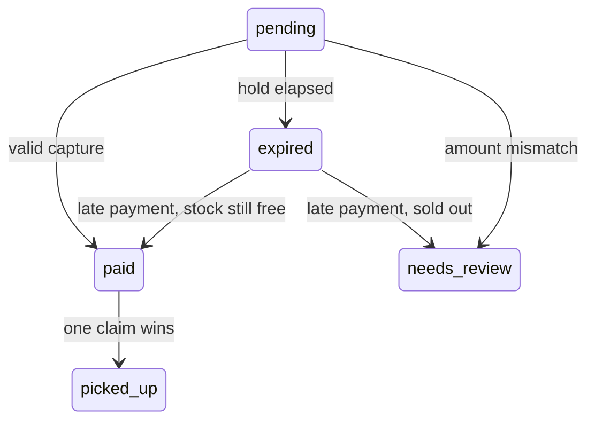

# Pickup Counter

Pickup Counter is a snack-ordering demo with a Next.js customer screen, an Express API and PostgreSQL. Orders reserve stock for a timed hold; signed payment captures either confirm the order or flag it for review. Real-database tests exercise competing customers, payment retries and expiry races. Paid orders can be claimed once; collection decrements stock in the same transaction.

[](https://github.com/ar-ease/assignmentProject/actions/workflows/ci.yml)

## Guarantees

Test names below are literal names from the files, including parameter placeholders.

| Guarantee | How it's enforced | Test that proves it |
| --- | --- | --- |
| Stock never oversold | Product row locks in ID order, followed by a fresh reservation query inside the transaction | `backend/tests/orders.test.ts`: `ten concurrent requests reserve exactly two Veg Puffs without overselling` |
| Holds expire and release units | Database deadlines; availability ignores overdue holds before lazy expiry or sweeping | `backend/tests/orders.test.ts`: `expired holds release stock before lazy expiry or the sweeper runs` |
| Webhooks are safe to repeat, sequentially and concurrently | Unique event ID insert and order update commit together | `backend/tests/payments.test.ts`: `sequential retries record one event and preserve paid_at`; `five simultaneous retries pay once and record one event` |
| Forged or tampered webhooks are rejected | HMAC-SHA256 over raw bytes; constant-time signature comparison before JSON parsing | `backend/tests/payments.test.ts`: `rejects %s signatures without recording events or changing orders`; `accepts signatures over exact bytes including whitespace and Unicode` |
| Wrong amounts are never marked paid | Capture amount must match the snapshotted total; mismatches enter review | `backend/tests/payments.test.ts`: `wrong amount flags review and exposes the reason on GET /orders/:id` |
| Late payments never oversell | Lock and recheck every product, excluding the paying order's own hold | `backend/tests/payments.test.ts`: `two late captures competing for the last stock cannot both pay`; `a capture delayed across expiry cannot take stock already reallocated to a new order` |
| Only one pickup succeeds | Conditional paid-to-picked_up UPDATE; stock decrement in the same transaction | `backend/tests/pickup.test.ts`: `two simultaneous pickup claims collect once and reject the loser`; `ten simultaneous pickup claims collect once and reject nine losers` |
| Stock never negative, CHECK constraint backstop | PostgreSQL `products_stock_check`, including raw SQL writes | `backend/tests/products.test.ts`: `database CHECK rejects negative stock even through raw SQL` |
| Countdown correct under clock skew | Server duration resynced against monotonic `performance.now()` | `frontend/lib/countdown.test.ts`: `ignores a wall clock skew of %i minutes`, exercised at +10 and -10 minutes |

## Quick start

Prerequisite: Docker with Compose. Run from the repository root:

```sh
docker compose up --build
```

With Colima, keep the checkout under your home directory or `/tmp/colima` so
the database initialization file is shared with its VM.

Open the frontend at http://localhost:3000; the API is at http://localhost:4000.
PostgreSQL uses localhost:5432. These ports must be free.

No `.env` file is needed. Compose supplies development defaults; `.env.example`
lists them, including `HOLD_SECONDS=120` and `WEBHOOK_SECRET=local-development-webhook-secret`.
Database initialization creates `pickup` and `pickup_test` on the first volume
initialization. Backend startup migrates and seeds; restarting preserves existing stock.

## Try it end to end

Keep Compose running. Use a second terminal in the repository root with a POSIX
shell or zsh. All Node commands below run inside Docker.

1. In the UI, add one snack and place an order. Copy the UUID from the payment
   page's URL. Run the block below; when `read` waits, paste the UUID and press Enter.
   The three webhook calls return `paid`, `duplicate`, then HTTP 401
   `INVALID_SIGNATURE`. The last command deliberately exits 1.

```sh
read -r ORDER_ID
EVENT_ID="evt_demo_$ORDER_ID"
docker compose exec -T backend npm run send-webhook -- "$ORDER_ID" --event "$EVENT_ID"
docker compose exec -T backend npm run send-webhook -- "$ORDER_ID" --event "$EVENT_ID"
docker compose exec -T backend npm run send-webhook -- "$ORDER_ID" --event "${EVENT_ID}_bad" --bad-signature
```

2. Place a **new** order in the UI. Paste its UUID when this block waits.
   Sending one paise returns `needs_review` with `amount_mismatch`.

```sh
read -r REVIEW_ORDER_ID
docker compose exec -T backend npm run send-webhook -- "$REVIEW_ORDER_ID" --event "evt_review_$REVIEW_ORDER_ID" --amount 1
```

3. Place another order and leave it unpaid past its hold, 120 seconds by default.
   The page shows expiry after the server confirms it. Paste that order's UUID
   below to see HTTP 200, `status: "expired"` and `expiresInSeconds: 0`.

```sh
read -r EXPIRING_ORDER_ID
docker compose exec -T backend node -e 'fetch("http://localhost:4000/orders/" + process.argv[1]).then(async r => console.log("HTTP", r.status, await r.text()))' "$EXPIRING_ORDER_ID"
```

4. Collect the paid order from step 1. The first call returns HTTP 200 with
   `status: "picked_up"`, `pickedUpAt` and `items`. The repeat returns HTTP 409
   `ALREADY_CLAIMED`. The payment page updates to **Order collected**.

```sh
curl -i -X POST "http://localhost:4000/orders/$ORDER_ID/pickup-claim"
curl -i -X POST "http://localhost:4000/orders/$ORDER_ID/pickup-claim"
```

The CLI fetches the order total unless `--amount` is supplied. `--event` fixes the
event ID; omitting it generates and prints one. `--status` defaults to `captured`.
Its `API_URL` defaults to `http://localhost:4000` and its HMAC secret matches Compose
unless overridden. The UI's UPI display is a demo placeholder, not a payment integration.

## Running tests

After building the stack, run:

```sh
docker compose run --rm backend npm test
docker compose run --rm --no-deps frontend npm test
```

- Backend: seven files cover validation, availability, concurrent holds and pickups,
  expiry, payment signatures/retries, late-payment races, CLI/configuration, stock
  constraints and the seeded 60-operation stress check. Result: **92 passed**. Tests migrate and truncate only `pickup_test`; never run
  backend test processes concurrently against that database.
- Frontend: two files cover cart caps, stock reconciliation, integer-paise totals,
  countdown advancement/resync/zero clamping, and wall-clock skew. Result: **8 passed**.
  These are unit tests, not browser tests.

Check the production frontend build separately:

```sh
docker compose run --rm --no-deps frontend npm run build
```

Local runs use each package's test script with Node 20 and installed dependencies;
backend tests also need a generated Prisma client and PostgreSQL, with `localhost` in database URLs.

## Architecture




An overdue pending order can also take the late-payment path before a read or sweep stores
`expired`. The handler checks the database deadline as well as the stored status.

## Decisions

### Computed availability

Availability is stock minus quantities on active pending holds and paid orders.
Creating, paying or expiring an order does not decrement stock. Expiry only stops
counting a reservation, so it cannot double-credit stock. Only a successful pickup
decrements stock; its paid reservation is released in the same transaction, leaving
available units unchanged.

### Row locking and recounting

Order creation locks products with `FOR UPDATE` in ascending ID order. It recounts
reservations in a separate statement after acquiring the locks, so PostgreSQL's
default READ COMMITTED isolation sees the previous lock holder's committed holds.
Payment also locks and recounts stock, excluding its own reservation.

### Lock-order rule

When an existing order and products are needed, lock the order first, then products
by ID. Creation locks products before inserting its new order. Pickup's conditional
UPDATE locks the order first, then it locks all products by ID before decrementing each.

### Database clock

PostgreSQL `now()` determines persisted timestamps, hold deadlines and server
seconds remaining. `HOLD_SECONDS` is configurable, defaults to 120, and must be a
positive integer no greater than 2,147,483,647. Client clocks never decide order state.

### Lazy expiry and cosmetic sweeper

Reading an overdue pending order stores `expired`. A five-second sweeper also
updates overdue rows, but availability already ignores their holds without either
update. The sweeper keeps stored status current; inventory safety does not depend on it.

### Webhook authentication and idempotency

HMAC-SHA256 covers the exact raw body before JSON parsing. A 64-hex-character
signature check ensures equal buffer lengths before `timingSafeEqual`. Raw parsing
has a 10kb limit and rejects compression. Startup rejects a missing or blank secret.

The unique `event_id` insert and order change commit in the same transaction;
concurrent retries wait on that insert and return `duplicate`. A failure rolls
back the event too, allowing a retry. Unknown orders are recorded and acknowledged
with 200 because provider retries cannot fix them; malformed UUIDs are stored as null.
Only `captured` proceeds to payment handling. Wrong amounts enter review; distinct
captures for final orders leave state unchanged and log a possible double charge.

### Late payment

I chose to honour a late capture only if every item is still available after
locking and recounting. Otherwise the order becomes `needs_review` with
`late_payment_stock_unavailable` for refund review. This keeps fulfilment possible
without taking stock promised to somebody else.

Always refunding late payments would reject orders that can still be fulfilled.
Always accepting would oversell when another order has reclaimed the stock.
Even captures started within a hold recheck stock because a lock wait can cross expiry.
PostgreSQL's transaction-time `now()` can conservatively count another hold that
expires during a long wait, causing review rather than overselling.

### Pickup and conflict codes

`POST /orders/:id/pickup-claim` conditionally updates only `status = 'paid'` to
`picked_up` and sets `picked_up_at = now()`. A concurrent claimant waits, re-evaluates
the predicate after the winner commits, and updates zero rows. A JS status check
alone cannot provide this guarantee.

Within the same transaction, pickup locks products in ascending ID order and
decrements each item's stock separately. The nonnegative-stock CHECK rolls back
the entire pickup if a decrement fails. There is no UPDATE ... FROM.

Invalid UUIDs return 400; missing orders return 404 `ORDER_NOT_FOUND`.
Conflicts return 409: `ALREADY_CLAIMED` for collected orders, `ORDER_NOT_PAID` for
active pending holds, `ORDER_EXPIRED` for expired or overdue pending orders, and
`ORDER_NEEDS_REVIEW` for payments under review.

### Countdown

The countdown uses server `expiresInSeconds` plus monotonic `performance.now()`,
resyncing on each response. Polls run two seconds after the previous request settles,
retry network failures, continue for pending/paid orders and stop on other statuses. Zero means checking payment
status; the browser never declares expiry. Reopening the page reads the current order.

### Prisma and money

Prisma handles CRUD and migrations. Raw SQL controls row locks, database time and
reservation aggregates. Money is integer paise throughout; the backend rejects
totals beyond PostgreSQL's signed integer limit.

## Assumptions

- One counter and one shared inventory; no counter or locker identity is modeled.
- Each product's merged quantity is 1–20 per order, including duplicate product IDs.
- `needs_review` orders do not reserve stock.
- Paid orders reserve stock until pickup, with no pickup deadline.
- Only webhook status `captured` can change an order through payment handling.
- Provider authentication is the shared HMAC. Customer/staff authentication is
  absent, and the locker pickup endpoint is unauthenticated.
- INR only; unit prices and the total are snapshotted when the order is created.
- PostgreSQL is authoritative for inventory and time. Seeds insert missing snacks
  and do not replenish existing products.

## How I verified this

Mutation checks used real PostgreSQL 16 and Node 20 in Docker against `pickup_test`,
with source/tests mounted read-only. The order, webhook and HMAC experiments were
recorded on 2026-10-24; pickup was checked on 2026-10-25. Each mutation ran alone three times.

| Mutation | Test | Result |
| --- | --- | --- |
| Remove `FOR UPDATE` from order creation's product query | `backend/tests/orders.test.ts`: `ten concurrent requests reserve exactly two Veg Puffs without overselling` | Failed 3/3 runs: **6, 9, then 3** of 10 orders succeeded for 2 units, instead of exactly 2. The race reproduced in these runs; scheduling is not deterministic. |
| Remove `AND status = 'paid'` from pickup UPDATE, keeping a JS status check | `backend/tests/pickup.test.ts`: `two simultaneous pickup claims collect once and reject the loser`; `ten simultaneous pickup claims collect once and reject nine losers` | Both failed in all 3 runs: two claims returned 2 successes; ten claims returned 10 successes, instead of exactly 1. A test-held order lock ensures every request reaches the UPDATE before release. |
| Skip the event insert and duplicate early return, processing every event | `backend/tests/payments.test.ts`: `sequential retries record one event and preserve paid_at`; `five simultaneous retries pay once and record one event` | Both failed in all 3 isolated runs. Sequential retry returned `ignored/already_final`, not `duplicate`; simultaneous retries returned 1 `paid` and 4 `ignored`, not 4 `duplicate`. The remaining final-status guard still prevented a second payment transition. |
| HMAC `JSON.stringify(JSON.parse(body))` instead of the raw bytes | `backend/tests/payments.test.ts`: `accepts signatures over exact bytes including whitespace and Unicode`; `rejects %s signatures without recording events or changing orders`; `checks signatures before attempting JSON parsing` | Each run had 3 failures and 5 passes: correctly signed whitespace JSON returned 401 instead of 200; the tampered-whitespace case returned 200 instead of 401; malformed JSON with an invalid signature returned 500 instead of 401. Same results on all 3 runs. The whitespace test already existed and was retained. |

For pickup, the correct implementation and diff were saved before mutation.
`git checkout -- backend/src/orders.ts` restored the indexed source and
`git diff --exit-code -- backend/src/orders.ts` confirmed an empty diff.
The saved correct implementation was then reapplied; its diff matched the saved
pre-mutation diff exactly. No mutation remains in the working tree.

The stress test `inventory and webhook invariants across 60 operations in three waves, seed 20261024`
mixes orders, captures, wrong amounts, forced expiry, duplicate events and four
competing pickup claims against a paid order. Independent SQL checks inventory,
conservation, event IDs and collection timestamps after each wave. Successful
pickup responses are counted per order: exactly one succeeds and three return
`ALREADY_CLAIMED`. The seed fixes random choices, not concurrent winners.

Three consecutive full-suite runs on restored source included this pickup stress test:

| Restored full-suite run | Result | Vitest duration |
| --- | --- | --- |
| 1 | 92 passed, including pickup stress | 7.40s |
| 2 | 92 passed, including pickup stress | 9.33s |
| 3 | 92 passed, including pickup stress | 7.64s |

The rebuilt stack also passed the live pickup walkthrough: signed payment, HTTP 200
pickup, then HTTP 409 `ALREADY_CLAIMED`. Earlier checks exercised the duplicate,
401, review and natural-expiry commands. Frontend tests passed 8 and the production
build passed; the changed backend tests passed strict TypeScript checking.
Browser controls were unavailable, so the UI was checked against source and builds.

Before the pickup change, an uncached build of a clean GitHub clone at `a3c2a9b` passed both suites and
the production build. Startup used a fresh database volume and a temporary override
that disabled published ports so the existing stack could stay running.

CI defines separate backend/frontend jobs on push and pull request, with PostgreSQL
16 for backend tests and a frontend production build. Both jobs passed for `a3c2a9b`
in [the verified CI run](https://github.com/ar-ease/assignmentProject/actions/runs/40110794151).

## Known limitations and what I'd do next

- Add an idempotency key to `POST /orders`; retrying a request can create duplicate holds.
- Implement refunds for `needs_review` and distinct double captures.
- Add a pickup deadline/release policy for paid but uncollected orders.
- Add locker/staff authentication, customer access control and rate limits; knowing
  an order UUID currently permits reading it, and any client can reserve stock.
- Measure hot-product lock contention; consider shorter transactions, bounded
  queuing or partitioning inventory by counter if contention becomes material.
- Add structured logs, metrics and alerts for failures, contention and review cases.
- Package and serve a production frontend build. The build passes, but the Compose
  frontend still runs the development server. CORS is fixed to localhost:3000.
- Resolve the remaining Prisma-tooling audit findings. This pass reported three
  high findings through `prisma` → `@prisma/config` → `deepmerge-ts`; dependencies
  were left unchanged.
- The new pickup implementation has not been pushed to hosted CI yet.

## Project structure

```text
backend/
  prisma/       Schema, migrations and idempotent snack seed.
  src/          Express routes, transactions, payments and expiry.
  scripts/      Signed payment-webhook simulator.
  tests/        Real-PostgreSQL API, CLI and invariant tests.
frontend/
  app/          Next.js menu and order/payment screens.
  lib/          API client, cart, money, countdown and unit tests.
docker/db/      Initial development/test database creation.
.github/        CI workflow.
```
