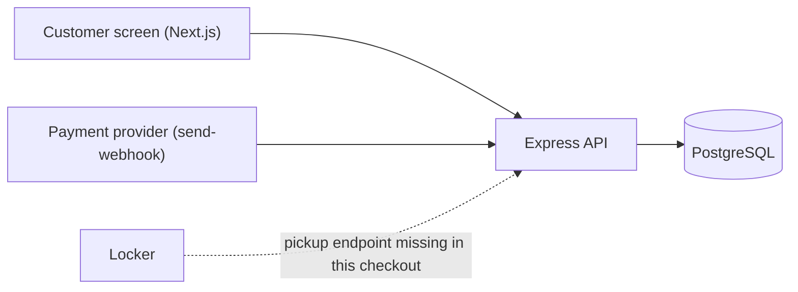
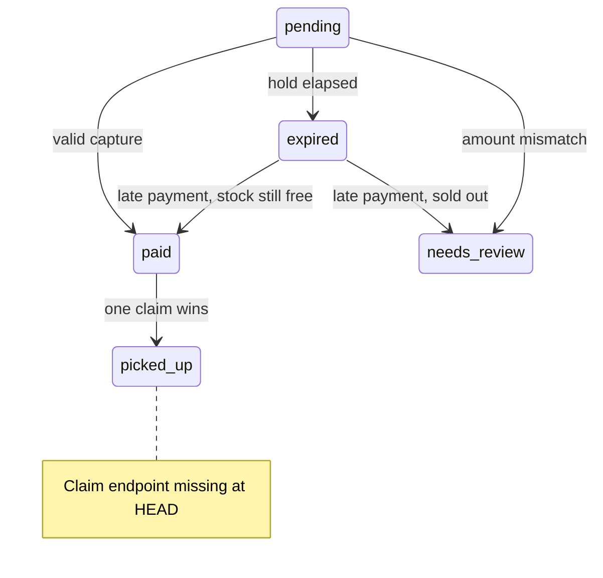

# Pickup Counter

Pickup Counter is a snack-ordering demo with a Next.js customer screen, an Express API and PostgreSQL. Orders reserve stock for a timed hold; signed payment captures either confirm the order or flag it for review. Real-database tests exercise competing customers, payment retries and expiry races. This checkout has no pickup claim endpoint, so pickup proof remains open.

[](https://github.com/OWNER/REPO/actions/workflows/ci.yml)

Replace `OWNER/REPO` in both badge URLs with your repository path.

## Guarantees

Test names below are literal names from the files, including parameter placeholders.

| Guarantee | How it's enforced | Test that proves it |
| --- | --- | --- |
| Stock never oversold | Product row locks in ID order, followed by a fresh reservation query inside the transaction | `backend/tests/orders.test.ts`: `ten concurrent requests reserve exactly two Veg Puffs without overselling` |
| Holds expire and release units | Database deadlines; availability ignores overdue holds before lazy expiry or sweeping | `backend/tests/orders.test.ts`: `expired holds release stock before lazy expiry or the sweeper runs` |
| Webhooks are safe to repeat, sequentially and concurrently | Unique event ID insert and order update commit together | `backend/tests/payments.test.ts`: `sequential retries record one event and preserve paid_at`; `five simultaneous retries pay once and record one event` |
| Forged or tampered webhooks are rejected | HMAC-SHA256 over raw bytes; constant-time signature comparison before JSON parsing | `backend/tests/payments.test.ts`: `rejects %s signatures without recording events or changing orders`; `accepts signatures over exact bytes including whitespace and Unicode` |
| Wrong amounts are never marked paid | Capture amount must match the snapshotted total; mismatches enter review | `backend/tests/payments.test.ts`: `wrong amount flags review and exposes the reason on GET /orders/:id` |
| Late payments never oversell | Lock and recheck every product, excluding the paying order's own hold | `backend/tests/payments.test.ts`: `two late captures competing for the last stock cannot both pay`; `a capture delayed across expiry cannot take stock already reallocated to a new order` |
| Only one pickup succeeds | Unverified: this checkout has no claim endpoint or conditional pickup UPDATE | No existing test. `backend/tests/invariants.test.ts` contains an explicit pickup TODO, not passing proof |
| Stock never negative, CHECK constraint backstop | PostgreSQL `products_stock_check`, including raw SQL writes | `backend/tests/products.test.ts`: `database CHECK rejects negative stock even through raw SQL` |
| Countdown correct under clock skew | Server duration resynced against monotonic `performance.now()` | `frontend/lib/countdown.test.ts`: `ignores a wall clock skew of %i minutes`, exercised at +10 and -10 minutes |

The backend supports products, orders with stock holds and expiry, and signed payment webhooks.
Step 5 adds the customer menu, cart and payment status screens in `frontend/`.

```sh
docker compose up --build
```

Open http://localhost:3000. Express runs at http://localhost:4000 and PostgreSQL at localhost:5432.
Compose has working development defaults; no `.env` file is required.
The init SQL creates `pickup` and `pickup_test` on the first volume initialization.

```sh
docker compose run --rm backend npm test
```

For local backend commands, use Node 20, run `npm ci` and `npx prisma generate` in `backend`,
and set `DATABASE_URL` and `TEST_DATABASE_URL` using `.env.example` values with `localhost` instead of `db`.
Set `WEBHOOK_SECRET` before starting the API; startup rejects missing or blank secrets.
`npm test` defaults to the local `pickup_test` URL and migrates it automatically.
Tests truncate only the test database. Do not run tests concurrently against that database.

The seed inserts missing snacks and preserves existing stock on restart.
The Docker backend startup runs migrations, seed, then the compiled server.

## Customer screen

At http://localhost:3000, add snacks to the cart and place an order. Quantities are capped
at available stock and 20 per item. Stock refreshes every five seconds and after each
order attempt; reduced stock adjusts the cart. All totals are calculated in integer paise.

The payment page is `/orders/<id>`, so refreshing or reopening its URL loads the same order.
It shows a demo UPI placeholder and a copyable command to simulate payment:

```sh
docker compose exec backend npm run send-webhook -- <id>
```

Order status polls every two seconds after the previous request completes, retries network
errors, and stops on paid, expired, needs_review or picked_up. The countdown resyncs from
the server's `expiresInSeconds` on every response and measures elapsed time with
`performance.now()`. Device wall-clock skew cannot change it. At zero, the screen checks
payment status and waits for the server to confirm expiry.

To work on the frontend locally, use Node 20 and run these commands in `frontend/`:

```sh
npm ci
npm run dev
npm test
npm run build
```

`npm test` runs small Vitest unit tests, including countdown advancement, resync, zero
clamping, and wall clocks set ten minutes ahead and behind, plus cart stock limits and
integer-paise calculations. `NEXT_PUBLIC_API_URL` defaults to `http://localhost:4000`.

## Decisions

- Lock product rows with `FOR UPDATE` in ID order to avoid deadlocks. Read reservations in a separate statement after locking so committed holds are visible under READ COMMITTED.
- Use the database clock for holds and countdowns.
- Expire orders lazily on reads and sweep every five seconds. The sweeper is cosmetic; overdue pending holds already stop reserving stock.
- Snapshot unit prices into `order_items` so product price changes do not change an order's total.
- Configure hold duration with positive integer `HOLD_SECONDS`, default 120. Values must fit a PostgreSQL integer.
- Verify `X-Signature` as hex HMAC-SHA256 over the exact raw request bytes before parsing JSON. The webhook mounts `express.raw()` before JSON routers, limits bodies to 10kb, and rejects compressed bodies so decompression cannot change the signed bytes. The API requires `WEBHOOK_SECRET` at startup.
- Insert the event and change the order in one transaction. `ON CONFLICT DO NOTHING` makes sequential and concurrent retries idempotent. A failed transaction rolls back its event too, allowing a provider retry to process it.
- When changing an existing order and locking stock, lock the order first, then products in ID order. Step 4 pickup must follow the same rule. After product locks, read reservations in a separate statement to see the previous lock holder's commits.
- Every correctly valued capture locks and rechecks stock, excluding its own hold. Even a capture started before expiry can wait while another order reclaims the released stock. This check prevents overselling when that delayed capture resumes. Expiry uses PostgreSQL transaction-time `now()` as elsewhere; a long lock wait can conservatively count another hold that has since expired, requiring review rather than risking overselling.
- A late capture rechecks stock under product locks using the shared reservation helper. Its expired hold does not reserve units. Honour the payment if every item is still available; otherwise set `needs_review` with `late_payment_stock_unavailable`. Never oversell to accept money, and never silently lose a customer's payment. Flag payments we cannot honour for a refund.
- A wrong amount sets `needs_review` with `amount_mismatch`. `GET /orders/:id` includes nullable `reviewReason`. Orders under review do not hold stock.
- Acknowledge unknown orders with 200 and record the event. Providers retry non-2xx responses, and retrying cannot fix an unknown order. Store malformed order IDs as null in the event's UUID column.
- Distinct captures for final orders log a warning and leave the order unchanged. A second capture for a paid order may be a double charge.

## Webhook edge cases

All 200 outcomes record the event, except a duplicate, which keeps the existing event.
Signature and body validation failures write nothing. Unexpected processing errors return 500 and roll back the event and order changes.

| Case | Response | Why |
| --- | --- | --- |
| Missing, non-hex, wrong-length, mismatched signature, or tampered body | 401 `INVALID_SIGNATURE` | Authenticate the raw bytes before parsing or writing. |
| Signed invalid JSON or schema | 400 `VALIDATION_ERROR` with readable message | Reject malformed input without recording an event. |
| Body over 10kb / compressed body | 413 / 415 | Bound memory use and preserve signed bytes. |
| Same event ID, sequentially or concurrently | 200 `{"result":"duplicate"}` | The event primary key serializes retries; `paid_at` stays unchanged. |
| Malformed UUID or unknown order | 200 `{"result":"ignored","reason":"unknown_order"}` | Keep an audit record and stop futile provider retries. |
| Status other than `captured` | 200 `{"result":"ignored","reason":"not_captured"}` | Only captured payments change orders. |
| Already `paid`, `picked_up`, or `needs_review` | 200 `{"result":"ignored","reason":"already_final"}` | Preserve final state and warn about a possible double charge. |
| Captured amount differs from total | 200 `{"result":"needs_review","reason":"amount_mismatch"}` | Flag the discrepancy for review. |
| Correct capture within active hold | 200 `{"result":"paid"}` | Set `paid_at` with the DB clock; paid items stay reserved. |
| Late capture, all stock available | 200 `{"result":"paid","late":true}` | Reclaim stock safely and honour the payment. |
| Late capture, any stock unavailable | 200 `{"result":"needs_review","reason":"late_payment_stock_unavailable"}` | Avoid overselling and flag the payment for refund. |

## Try it

Start the stack with `docker compose up --build -d`. From the repository root, place an order
and capture its ID. These commands use Node, so no `jq` installation is needed.

```sh
ORDER_ID=$(curl -fsS http://localhost:4000/orders \
  -H 'Content-Type: application/json' \
  -d '{"items":[{"productId":1,"quantity":1}]}' \
  | node -pe 'JSON.parse(require("fs").readFileSync(0, "utf8")).id')

# Host: fetches the order total and generates/prints an evt_<random> eventId.
(cd backend && npm run send-webhook -- "$ORDER_ID")

# Copy the printed eventId to resend exactly the same event.
EVENT_ID=evt_replace_with_printed_id
(cd backend && npm run send-webhook -- "$ORDER_ID" --event "$EVENT_ID")

# Deliberately rejected with HTTP 401. The script exits 1 on non-2xx responses.
(cd backend && npm run send-webhook -- "$ORDER_ID" --bad-signature)

# The same script is also available inside the running backend container.
docker compose exec backend npm run send-webhook -- "$ORDER_ID" --event "$EVENT_ID"
```

The CLI reads `API_URL`, default `http://localhost:4000`, and `WEBHOOK_SECRET`,
default `local-development-webhook-secret`, matching Compose. Export the same secret on the host
if you changed it in Compose. Inside the backend container, localhost points to its own API.
The CLI does not need database credentials. Optional `--amount <paise>` skips the order fetch;
`--status <status>` defaults to `captured`. For example, use `--amount 1` to demonstrate review
or `--status failed` on a fresh order to demonstrate an ignored event.

## Next steps

- Add a refund flow for amount mismatches, unavailable late-payment stock, and potential double charges from distinct captures of an already-paid order. Step 3 records/warns but does not issue refunds.

## Architecture



The locker connection and `paid` to `picked_up` transition describe the intended pickup
flow. They are not implemented or verified in this checkout.



An overdue pending order can also take the late-payment path before a read or sweep stores
`expired`. The handler checks the database deadline as well as the stored status.

## How I verified this

Mutation checks ran against real PostgreSQL 16 in Docker with Node 20 on 2026-10-24.
Each available mutation ran alone. Only the tests named below ran, three times per
mutation. Source and test directories were mounted read-only into each test container
so it tested the working files rather than an older image. All runs used `pickup_test`.

| Mutation | Test | Result |
| --- | --- | --- |
| Remove `FOR UPDATE` from order creation's product query | `backend/tests/orders.test.ts`: `ten concurrent requests reserve exactly two Veg Puffs without overselling` | Failed 3/3 runs: **6, 9, then 3** of 10 orders succeeded for 2 units, instead of exactly 2. The race reproduced in these runs; scheduling is not deterministic. |
| Remove `AND status = 'paid'` from pickup UPDATE, keeping a JS status check | Simultaneous-claims tests | Not run. Neither the pickup UPDATE nor claim tests exist at HEAD `fe7940e`. This is a gap, not a surviving mutation or proof of safety. |
| Skip the event insert and duplicate early return, processing every event | `backend/tests/payments.test.ts`: `sequential retries record one event and preserve paid_at`; `five simultaneous retries pay once and record one event` | Both failed in all 3 isolated runs. Sequential retry returned `ignored/already_final`, not `duplicate`; simultaneous retries returned 1 `paid` and 4 `ignored`, not 4 `duplicate`. The remaining final-status guard still prevented a second payment transition. |
| HMAC `JSON.stringify(JSON.parse(body))` instead of the raw bytes | `backend/tests/payments.test.ts`: `accepts signatures over exact bytes including whitespace and Unicode`; `rejects %s signatures without recording events or changing orders`; `checks signatures before attempting JSON parsing` | Each run had 3 failures and 5 passes: correctly signed whitespace JSON returned 401 instead of 200; the tampered-whitespace case returned 200 instead of 401; malformed JSON with an invalid signature returned 500 instead of 401. Same results on all 3 runs. The whitespace test already existed and was retained. |

After each mutation, `git checkout -- <file>` restored the source and
`git diff --exit-code HEAD -- <file>` confirmed no difference. The final source diff
must remain empty. No mutation is part of the finished change.

To repeat a selected check from the repository root, temporarily make only its mutation,
then run this command three times with the file and `-t` filter from the table:

```sh
docker compose run --rm \
  -v "$PWD/backend/src:/app/src:ro" \
  -v "$PWD/backend/tests:/app/tests:ro" \
  backend npm test -- tests/orders.test.ts -t 'ten concurrent requests'
# Restore after the experiment, even if the test fails:
git checkout -- backend/src/orders.ts
git diff --exit-code HEAD -- backend/src/orders.ts
```

The duplicate-webhook filter is `sequential retries|five simultaneous retries`; the
signature filter is `signatures|signature`. Both use `tests/payments.test.ts`.

`backend/tests/invariants.test.ts` runs `inventory and webhook invariants across 60
operations in three waves, seed 20261024`. A seeded generator chooses products,
quantities, existing orders and operation order before each `Promise.all`. About 65%
of product choices target the two-unit Veg Puff. Later waves mix orders, valid captures,
wrong amounts, copies of events already sent in an earlier wave, and conditional SQL
updates that force pending deadlines into the past. The seed reproduces random choices;
database scheduling and which competing requests win can still vary.

After every wave, independent database queries check nonnegative stock and availability,
stock plus collected quantities against initial stock, exact distinct webhook event IDs,
and timestamps on any collected orders. The test also requires actual paid and review
outcomes, at least one forced expiry and four acknowledged duplicates. Pickup requests
and the successful-claim count invariant remain an explicit TODO. No picked-up orders
are produced, so conservation and pickup timestamp checks do not prove collection safety.

| Consecutive stress run | Result | Vitest duration |
| --- | --- | --- |
| 1 | 1 passed, 1 pickup TODO | 1.60s |
| 2 | 1 passed, 1 pickup TODO | 1.31s |
| 3 | 1 passed, 1 pickup TODO | 1.21s |
| 4 | 1 passed, 1 pickup TODO | 1.06s |
| 5 | 1 passed, 1 pickup TODO | 1.11s |

Final verification on the restored source: backend **80 passed, 1 pickup TODO** across
6 files; frontend **8 passed** across 2 files; the Node 20 production build passed,
including TypeScript checking. The two changed backend test files also passed a
separate strict TypeScript check. Application source has no diff against HEAD.

## CI first run

`.github/workflows/ci.yml` runs on every push and pull request. Separate `backend` and
`frontend` jobs use Node 20, `npm ci` and npm caches keyed by each package's lockfile.
The backend gets a PostgreSQL 16 service with matching `pickup` credentials and a
`pickup_test` database; the existing database-name guard is unchanged. Vitest's global
setup deploys migrations before the tests. The frontend runs its tests and production build.
Service networking and cache configuration follow the
[GitHub PostgreSQL example](https://docs.github.com/en/actions/tutorials/use-containerized-services/create-postgresql-service-containers)
and [setup-node documentation](https://github.com/actions/setup-node/tree/v6#caching-global-packages-data).

The workflow has not run on GitHub yet. On its first run, check:

1. Both jobs appear under **Actions → CI** for the pushed commit or PR.
2. Setup Node reports v20 and looks for the correct package lockfile. A first-run cache
   miss is expected; later runs can restore it.
3. The backend Postgres service becomes healthy. Prisma generation succeeds and test
   migration output names `pickup_test` at `localhost:5432`, then applies two migrations.
4. Backend tests finish without failures; the pickup TODO must remain visible until the
   missing implementation and proof are supplied. Green CI alone does not close that gap.
5. Frontend tests pass, and `next build` completes TypeScript checking and lists `/` and
   `/orders/[id]`. Neither job needs a separately running API or a repository secret.
